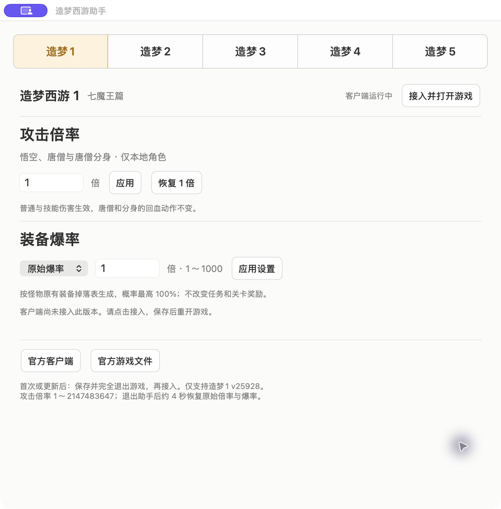

# 造梦西游

统一维护造梦西游系列辅助工具。目前支持造梦1（v25928）攻击倍率与爆率调整；造梦2（v25928）攻击、爆率/Boss掉落、强化/合成、强化石添加和翅膀背包修复；造梦3（v261029）攻击、爆率/Boss指定掉落、经验、强化、炼丹及白名单物品/宠物潜能添加；造梦4 V58.8与造梦5 V47.8支持攻击倍率。

仓库：https://github.com/xc66xc/zaomeng-xiyou

## 项目预览

浅色原生 Mac 面板，突出倍率输入与应用操作；顶部通过带清晰分界线的整块按钮切换造梦1、2、3、4、5，选中章节以浅琥珀色突出，不显示辅助小字；各自保留本次运行的倍率与状态；造梦2提供「战斗与掉落」「强化与合成」「强化石与翅膀」，造梦3提供「战斗与掉落」「炼丹与强化」「物品与宠物」分类；造梦1在同一面板调整攻击和爆率。支持恢复1倍、下载官方依赖并接入游戏。



## 下载与使用

从本仓库 **Releases** 下载 `macos-arm64.zip`，解压后打开「造梦西游攻击助手.app」。软件版本以 `zm5-only/Info.plist` 为唯一来源。

当前只验证 Apple Silicon、macOS 12+。应用使用本地 ad-hoc 签名，未做 Apple Developer ID 签名或公证，首次打开可能遇到系统安全确认。兼容客户端为旧版 Intel Electron/PepperFlash 微端，Apple Silicon 可能需要系统安装 Rosetta。不能把 App Store 手游或普通浏览器当成这个客户端。

发布包**不包含第三方客户端、Flash插件或完整游戏SWF**。首次使用需用户自行下载：

- [淘米官方客户端下载页面](https://webres.61.com/common/flash/common_micro.html?game=mole)，其官方配置列出的[Mac客户端](https://dl.61.com/mole/Mole.dmg)。
- [4399官方游戏入口](https://www.4399.com/flash/zmhj.htm)。
- 先切换造梦1、2、3、4或5，再点击「官方游戏文件」下载该章节支持的原始文件（造梦1、2均为 `v25928.swf`，但来源路径与校验值不同，不能混用，造梦3为 `v261029.swf`，造梦4为 `v5880.swf`，造梦5为 `v4780.swf`），自行选择保存位置。该按钮仅按用户操作请求4399官方源，附官方来源页并校验内容；直接在浏览器打开SWF裸链接可能收到提示文件，不能据HTTP 200判断下载成功。

保存并完全退出游戏，再点击助手「接入并打开游戏」。未检测到客户端时选择已安装的兼容 `.app`；助手会将所选客户端本地改名为「造梦西游」，并将其游戏入口设为4399官方专题页。需要对客户端目录有写入权限。为兼容旧Electron，保留内部Helper标识，个别系统菜单可能仍显示旧名称。

首次为所选章节选择从官方取得的原始SWF，助手会在本机校验并生成补丁，不下载或上传账号及游戏数据。已有同版补丁可以直接复用。之后进入对应章节，输入正整数倍率并应用，1倍还原。造梦1支持悟空、唐僧及唐僧分身的攻击倍率，唐僧与分身回血不变；爆率可选原始、1～1000倍或必掉，只作用于怪物原有普通装备掉落表，概率最高100%，无掉落表时不创建装备，不含Boss指定掉落或材料添加。造梦2支持三角色和唐僧影子的攻击，唐僧/影子回血不变；「战斗与掉落」提供爆率倍率/必掉与64项Boss白名单，「强化与合成」提供对应必成开关，原有材料消耗逻辑保留；「强化石与翅膀」可为玩家1或2添加1～4级强化石（每堆最多999），或将已有刑天之翼从错误的道具/装备背包移回时装背包。修复保留原对象及属性，不创建新翅膀；背包满、重复堆叠或玩家未就绪时停止。造梦3只修改本地玩家四角色的普通和技能伤害，排除唐僧回血/辅助动作及联网竞技模式；另外支持下列功能，新开关默认关闭，倍率默认1：

| 造梦3功能 | 使用边界 |
|---|---|
| 爆率倍率/必掉 | 倍率1～1000，概率最高1；不改变任务或关卡奖励 |
| Boss指定掉落 | 从白名单选择，替换普通掉落，保留游戏拾取路径 |
| 经验倍率 | 1～1000，仅怪物经验；放大结果最高1亿（原本更高的值不降低），不改变等级上限 |
| 装备强化必成 | 仍需原有材料，不承诺其他合成必成 |
| 炼丹最高基础属性、法宝指定五行 | 仅制作/合成生成属性，不追改已有装备 |
| 材料、碎片、转换石、丹药、装备、称号相关物品 | 白名单、数量与背包容量检查；称号物品不等于自动解锁称号 |
| 宠物潜能 | 当前出战宠物；只有一只宠物时可选该宠物，多只且未出战时停止 |

「物品与宠物」选择具体项目和数量，点击「添加一次」才执行。只发给当前客户端，超过15秒失效；不会自动重试。看到成功回执后自行在游戏中保存；结果不明时先检查游戏，避免重复添加。添加不会自动使用、出售物品或消耗潜能。旧记录中误称“天书”“琦石”的项目按真实表名分别列为“天枢石”“祁水制作书”。游戏内的新功能效果由用户本人验证，已反馈正常。

造梦4只影响单人副本角色对怪物的普通和技能伤害，排除组队、PK和联盟Boss，不声明宠物支持；造梦5影响本人角色/宠物/幻兽在单人副本中的普通和技能伤害，独立真实伤害保持原逻辑。各章节倍率分开维护，切换界面不把一个章节的倍率应用到另一个章节；关闭助手后各章节约4秒恢复原倍率。

这是“下载助手 + 首次自行准备官方依赖”的流程，不是零依赖的一体包。下载来源是否持续可用、后续官方客户端是否仍兼容，需要按实际版本核验。

## 构建与验证

需要 Xcode Command Line Tools、Node.js 22+、Python 3.10+：

```sh
node --test zm5-only/attack.test.cjs
ZMXY_PACKAGE_WITHOUT_GAME=1 zsh zm5-only/build.sh /tmp/造梦西游攻击助手.app
```

原始游戏不在构建输入中：发布包仅包含自写程序、脚本和每篇少量变换指令。用户本地生成结果须匹配已验证的哈希，不支持拿未知游戏版本尝试套用。

本地开发者可自备 Java/JPEXS FFDec、原始游戏及工作目录重建伤害补丁：

```sh
export FFDEC_JAR=/absolute/path/to/ffdec.jar
export ZMXY_PATCH_WORKDIR=/absolute/path/to/local/workdir
java -jar "$FFDEC_JAR" -swf2xml "$ZMXY_PATCH_WORKDIR/original.swf" "$ZMXY_PATCH_WORKDIR/original.xml"
java -jar "$FFDEC_JAR" -selectclass prefabs.controls.DamageControl -format script:pcode -export script "$ZMXY_PATCH_WORKDIR/pcode" "$ZMXY_PATCH_WORKDIR/original.swf"
python3 tools/build_patch.py
python3 tools/make_delta.py "$ZMXY_PATCH_WORKDIR/original.swf" "$ZMXY_PATCH_WORKDIR/release.swf" /tmp/patch-v4780.json
```

造梦1使用同样环境变量运行 `python3 tools/build_patch1.py`，仅修改三处攻击方法与普通装备掉落概率，生成 `patch-zm1-v25928.json`；与造梦2同名版本号的原始文件按独立哈希校验。

造梦2使用同样环境变量运行 `python3 tools/build_patch2.py`，从当前官方v25928外壳提取内层游戏，只替换目标方法并生成嵌套变换JSON。强化石与翅膀操作仅在用户点击时发送单次请求，绑定客户端、玩家与15秒期限，未知结果不自动重试。

造梦3使用同样环境变量运行 `python3 tools/build_patch3.py`，会从当前官方外壳提取内层游戏、修改目标攻击、掉落、经验、强化、炼丹与命令方法，并直接生成嵌套变换JSON。不要对重压缩后的外层游戏生成普通flat delta，以免变换指令意外包含大量完整游戏数据。原生补丁引擎在本机校验并重建内层，造梦4、5仍使用原flat格式。

造梦4的补丁重建使用同样环境变量：先对V58.8原始文件导出XML与 `models.managers.BattleModelManager` p-code，再运行 `python3 tools/build_patch4.py`，最后用 `tools/make_delta.py` 生成变换指令。

原始文件、生成的完整SWF、反编译结果和工具本体均不应上传。可用 `ZMXY_PATCH_PATH` 指定自己的本地补丁构建自用包，不得把带第三方资源的自用包当成公开Release附件。

CI验证倍率逻辑、输入校验、协议、章节隔离、复制粘贴快捷键、本地补丁引擎的生成样本及无SWF构建。真实官方原始文件在本机生成的结果已与已验证补丁逐字节匹配；改名后的本机客户端已冷启动，并成功加载本地生成的补丁进入V47.8开始游戏画面；造梦4 V58.8已完成本机原始文件生成补丁、回读与冷启动验证；攻击倍率由用户本人实战确认正常。造梦3攻击倍率由用户本人实战确认正常；本次恢复的其他功能已由用户本人游戏内验收并反馈正常；不据此宣称所有角色与关卡均已覆盖。造梦2已由用户本人验收并反馈正常，不据此声明全角色、全物品或全关卡覆盖。造梦1攻击与爆率已由用户本人验收并反馈正常，不据此声明全角色与全关卡覆盖。其他用户机器未实测。

## 性能与协作

每秒分别写入造梦1、2、3、4、5的小配置文件，客户端每秒轮询两次读取五篇配置，伤害回调执行常数次判断及乘法。相比原单篇版本，配置文件操作略增，不增加战斗网络调用；未做CPU/内存基准，不能宣称资源增量为零。首次生成补丁涉及本地解压、拷贝和SHA256校验，开销与输入文件大小线性相关，会临时持有多个文件缓冲区；不在战斗伤害回调中执行。本地生成结果以未压缩FWS保存，相比旧版约2.2MB压缩文件会增加客户端加载时的本地读入量和缓存，不能声称整体内存完全不变。未测端到端耗时与峰值内存，不能将原精简版的空闲读数当作本版实测。Electron桥会缓存已访问章节的补丁：造梦4文件约7.38MB，造梦3/4/5都访问后原始Buffer按当前补丁文件大小合计约20.31MB，另有请求时临时Base64开销；这是按文件大小估算，不是进程峰值内存实测。造梦2新增一份小配置，读取/写入频率按相同轮询规则保持不变，首次访问时额外缓存该章节补丁；造梦2本地补丁约2.85MB、公开嵌套变换约12KB；四篇都访问后原始补丁Buffer合计约23.16MB，另有临时Base64与重建缓冲区，按文件大小估算，不是进程峰值内存实测。造梦1额外新增每秒1份配置写入、2次读取，不增加轮询频率；本地补丁实测文件大小2.51MB，公开变换3192字节，五篇全部访问时原始Buffer按文件大小估算约25.67MB，并非峰值内存实测。新增开关仍使用同一轮询，不提高轮询频率。物品添加只在点击时执行一次有界背包扫描，未决请求不重试；不新增外部服务调用或日志无限追加。本次造梦3完整本地补丁约5.88MB，比仅攻击版增加约10KB；发布的嵌套变换JSON约59KB。当前函数与目录序列化按造梦2约14.6KB/次、造梦3约25.6KB/次，单游戏帧2Hz分别估算约29KB/s和51KB/s本机CDP数据（不含协议开销），不是外网流量或CPU/峰值内存实测。Boss查找最多135项；只读接口握手每轮最多一次。没有额外持续网络调用；官方文件由用户自行下载。

从最新main建短期 `feat/*`、`fix/*`、`docs/*` 或 `chore/*` 分支；外部贡献使用Fork + PR。通过CI后Squash merge，初次交付及版本升级均使用匹配manifest的 annotated `vX.Y.Z` Tag触发正式Release。发布权限仅用于Tag构建，普通外部PR只读。

## 许可

MIT只覆盖本仓库自写代码，见LICENSE。第三方游戏、客户端、Flash及美术不在许可范围内，也不在发布包中。macOS系统提供解压库实现，本仓库只包含接口调用。不要上传账号、存档、个人截图、第三方游戏文件或下载工具本体。

## 赞赏支持

项目免费开源。如果对你有帮助，欢迎自愿赞赏支持。

<table>
  <tr><th>支付宝</th><th>微信支付</th></tr>
  <tr>
    <td></td>
    <td></td>
  </tr>
</table>
